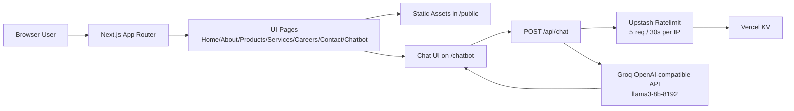
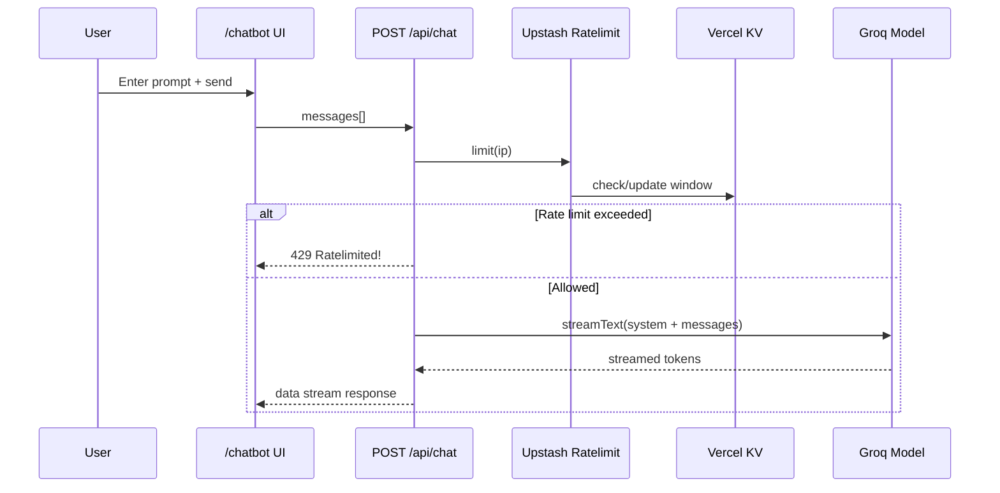

# Triyas Website

A marketing and information website for **Triyas** built with Next.js. The app presents Triyas services/products, includes a careers and contact experience, and provides a chatbot backed by a server route with rate limiting.

## Value Proposition

This project combines a content-rich company website with an AI assistant that answers from curated Triyas domain content, helping visitors understand offerings and get quick answers in one place.

## Features

- Multi-page App Router website (`/`, `/about`, `/products`, `/services`, `/careers`, `/contact`, `/chatbot`)
- Shared header/footer layout across pages
- Service and product showcase sections with rich media from `public/`
- Client-side chat UI (`ai/react`) on `/chatbot`
- Backend API route at `POST /api/chat` using Groq-compatible OpenAI SDK
- Rate limiting with Upstash Ratelimit + Vercel KV (5 requests / 30 seconds per IP)

## Technology Stack

- **Framework:** Next.js 14 (App Router)
- **Language:** TypeScript + React 18
- **Styling:** Tailwind CSS + global CSS
- **AI/LLM:** `ai` SDK + `@ai-sdk/openai` (configured for Groq API)
- **Data/Infra services:** `@vercel/kv`, `@upstash/ratelimit`
- **Icons/UI:** `lucide-react`

## Prerequisites

- Node.js (18+ recommended for Next.js 14)
- npm (project includes `package-lock.json`)

## Installation & Setup

```bash
git clone https://github.com/Harshavardhanjakku/triyas-website.git
cd triyas-website
npm install
```

Create `.env.local` in the project root:

```bash
API_KEY=your_groq_api_key
# Required by @vercel/kv runtime used in src/app/api/chat/route.ts
KV_REST_API_URL=your_kv_rest_api_url
KV_REST_API_TOKEN=your_kv_rest_api_token
```

> `API_KEY` is explicitly used in the chat route. KV variables are required for the KV-backed rate limiter.

## Available Scripts

From `package.json`:

- `npm run dev` — start local development server
- `npm run build` — production build
- `npm run start` — run production server
- `npm run lint` — run Next.js linting

## Development Workflow

```bash
npm run dev
# open http://localhost:3000
```

## Repository Structure

```text
triyas-website/
├── public/                     # Static assets used by all pages (images/webp/branding)
├── src/
│   └── app/
│       ├── api/chat/route.ts   # POST chat API with Groq model + rate limiting
│       ├── components/
│       │   ├── Header.tsx      # Top navigation links
│       │   ├── Footer.tsx      # Footer/contact/social links
│       │   └── ImageSlider.tsx # Unused slider component (present in repo)
│       ├── about/page.tsx
│       ├── careers/page.tsx
│       ├── chatbot/page.tsx
│       ├── contact/page.tsx
│       ├── products/page.tsx
│       ├── services/page.tsx
│       ├── layout.tsx          # Global layout + metadata + Header/Footer wrapper
│       ├── page.tsx            # Home page
│       └── globals.css
├── next.config.mjs
├── tailwind.config.ts
├── tsconfig.json
└── package.json
```

## Architecture Diagram



## User / Request Flow



## Routes and API

### Frontend routes

- `GET /` — homepage
- `GET /about`
- `GET /products`
- `GET /services`
- `GET /careers`
- `GET /contact`
- `GET /chatbot`

### Backend/API routes

- `POST /api/chat`
  - Input: JSON body with `messages`
  - Behavior: rate limit by IP, call Groq model with fixed Triyas system context, stream response
  - Error response: `429 Ratelimited!` when quota exceeded

## Deployment Guidance

This is a standard Next.js app and can be deployed on platforms that support Node.js/Next.js (for example Vercel).

Typical production flow:

```bash
npm run build
npm run start
```

Ensure all environment variables are configured in your deployment platform (`API_KEY`, KV variables).

## Screenshots / Demo

- No dedicated screenshot markdown or live demo URL is defined in this repository.
- Visual assets used by the site are available under `/public`.

## Contributing

No repository-specific contribution guide is currently included. If you want to contribute, open an issue or pull request with clear scope and testing notes.

## License

No license file is currently present in this repository.
